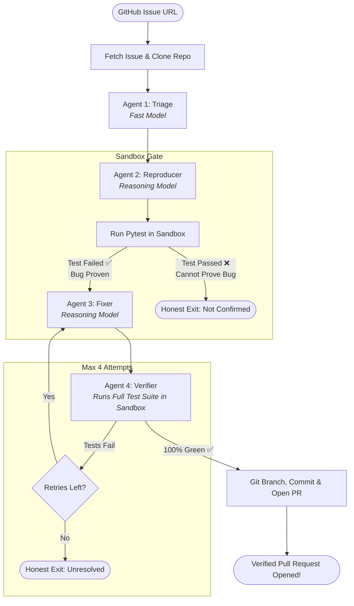

# 🤖 Bug-to-PR Agent

> *"Copilot suggests code. We ship verified fixes."*

[](#-what-makes-us-different)
[](LICENSE)
[](https://www.python.org/)
[](https://groq.com/)

An autonomous multi-agent software engineering system that ingests a **GitHub Issue URL** and outputs a **fully verified Pull Request**—guaranteed by an automated regression test authored and proven *before* the fix is written.

---

## ⚡ Empirical Benchmark Results

The pipeline is benchmarked against real seeded bugs to measure execution latency, test integrity, and automated fix accuracy:

| Benchmark Issue | Target Defect | Reproduction & Proof | Resolution Time | Retries | Verified PR |
|---|---|---|---|---|---|
| **[Issue #1](https://github.com/Trident1211/Demo-buggy-repo/issues/1)** | Pagination drops last page element | ✅ Reproducing test written & failed | **13.08s** | 0 | **[PR #3](https://github.com/Trident1211/Demo-buggy-repo/pull/3)** |
| **[Issue #2](https://github.com/Trident1211/Demo-buggy-repo/issues/2)** | Discount $>100\%$ yields negative price | ✅ Reproducing test written & failed | **12.75s** | 0 | **[PR #4](https://github.com/Trident1211/Demo-buggy-repo/pull/4)** |

---

## 💡 The Problem

Engineering teams and maintainers spend disproportionate time diagnosing bug reports, reproducing edge cases, and manually verifying regressions. While modern coding assistants generate plausible patches, **they cannot prove them**:
- They do not reproduce the defect in an isolated environment.
- They cannot prove that the patch eliminates the failure.
- They do not verify whether existing features silently broke.
- **Developers are still forced to verify and test everything by hand.**

---

## 🏆 What Makes Us Different

AI that writes code is not new. **Our differentiator is test-first proof of correctness:**

1. **Test-First Verification:** A failing regression test is generated and proven to fail in the sandbox *before* any patch is written. That regression test ships directly inside the PR as permanent proof.
2. **Honest Failure (Zero Hallucinated PRs):** If the pipeline cannot reliably reproduce the defect or fails the test suite within its retry budget, it **stops and reports honestly**. It will never open an unverified or speculative PR.
3. **Safe by Design:** Code and tests execute in an isolated sandbox (`SANDBOX_MODE=docker` or `local`), disabling network access during test runs and restricting file writes strictly to the target repository.
4. **Deterministic Replay System:** Every pipeline execution generates an immutable trace in `runs/*.json`. Users can inspect every state transition, test failure log, and unified diff locally or via the web console without requiring API keys.

---

## 🔄 Multi-Agent Architecture

The resolution engine is orchestrated as a state machine:



### Agent Roles:
- **Triage Agent (`openai/gpt-oss-20b`):** Analyzes the issue title, body, and repository file tree to pinpoint the affected files and symbols. Automatically loads relevant source snippets into working memory.
- **Reproducer Agent (`openai/gpt-oss-120b`):** Writes a minimal, self-contained `pytest` regression test. If this test does not fail on the current code, the pipeline aborts immediately (honest verification gate).
- **Fixer Agent (`openai/gpt-oss-120b`):** Produces a surgical unified diff. The Fixer is strictly isolated from modifying or weakening the reproducer's test file.
- **Verifier Agent (`openai/gpt-oss-20b`):** Applies the patch to a sandbox copy of the repo and executes the full test suite. Ensures zero regressions were introduced.
- **PR Automator:** Bundles the regression test + source patch, creates an isolated branch, pushes to GitHub, and opens a Pull Request complete with root cause, test evidence, and diff explanations.

---

## 📁 Repository Layout

```
BUG_2_PR/
├── .github/
│   ├── ISSUE_TEMPLATE/
│   │   ├── bug_report.yml       # Structured bug report template
│   │   └── feature_request.yml  # Feature enhancement proposal template
│   └── pull_request_template.md # Standardized PR review checklist
├── demo_repo/                   # Seeded bug testbed (pagination & pricing defects)
│   ├── api/
│   │   └── pagination.py
│   ├── ecommerce/
│   │   └── pricing.py
│   └── tests/
│       ├── test_pagination.py
│       └── test_pricing.py
├── runs/                        # Immutable JSON execution traces for replay
├── main.py                      # CLI Entrypoint (python main.py <issue_url>)
├── graph.py                     # Multi-agent state machine orchestrator
├── llm.py                       # Groq LLM client with caching & self-repair
├── prompts.py                   # Structured prompts with JSON output contracts
├── sandbox.py                   # Docker/Local isolated test execution & patch applier
├── gh.py                        # GitHub REST API client (clone, issues, PRs)
├── recorder.py                  # Saves immutable execution traces to runs/
├── smoke_test.py                # Module-level integration smoke test suite
├── test_pipeline_e2e.py         # End-to-end simulation unit tests
├── Dockerfile                   # Minimal Python sandbox container
├── requirements.txt             # Project dependencies
├── .env.example                 # Environment variables template
├── .gitignore                   # Git ignore definitions
├── ARCHITECTURE.md              # Multi-agent protocol & state schema specification
├── BENCHMARKS.md                # Empirical evaluation & benchmark report
├── CONTRIBUTING.md              # Contributor guidelines and coding standards
├── CODE_OF_CONDUCT.md           # Community standards and covenant
├── SECURITY.md                  # Sandbox isolation & security model policy
└── LICENSE                      # MIT Open Source License
```

---

## 🚀 Quickstart Guide

### 1. Prerequisites
- Python 3.11+
- Git

### 2. Installation
```bash
git clone https://github.com/anushkakhandelwal21/BUG_2_PR.git
cd BUG_2_PR
pip install -r requirements.txt
```

### 3. Environment Setup
Copy `.env.example` to `.env`:
```bash
cp .env.example .env
```
Configure your credentials:
```ini
GROQ_API_KEY=gsk_your_groq_api_key
GITHUB_TOKEN=ghp_your_github_personal_access_token
SANDBOX_MODE=local   # or 'docker' for containerized runs
```

---

## 💻 Running the Autonomous Agent

Trigger the end-to-end resolution pipeline for any GitHub issue:
```bash
python main.py https://github.com/Trident1211/Demo-buggy-repo/issues/1
```

**Terminal Execution Trace:**
```text
============================================================
  [Bug-to-PR Agent] Autonomous Bug Resolution
============================================================

[+] Fetching issue: https://github.com/Trident1211/Demo-buggy-repo/issues/1
   Title: Bug: Pagination drops the last item on each page
   Repo:  Trident1211/Demo-buggy-repo

[+] Cloning repository...
[+] Starting multi-agent pipeline...
   Triage -> Reproducer -> Fixer -> Verifier

[+] Run record saved: runs/run_20261024_161128_e345224f.json

============================================================
  [SUCCESS] PR opened!
  PR URL:   https://github.com/Trident1211/Demo-buggy-repo/pull/3
  Duration: 13.08s
  Retries:  0
============================================================
```

---

## 🌐 Web Console & Replay System

The system exports full execution traces as structured JSON artifacts into `runs/`. These records power our web console:

- **Interactive Timeline:** Step-by-step visibility through Triage, Reproducer, Fixer, and Verifier stages.
- **Trace Inspector:** Side-by-side inspection of generated regression tests, pytest failure traces, and unified diff patches.
- **Zero-Dependency Exploration:** Historical runs can be reviewed with full fidelity without requiring live API keys or local execution environments.

---

## 📄 License
This project is open-source under the MIT License.
